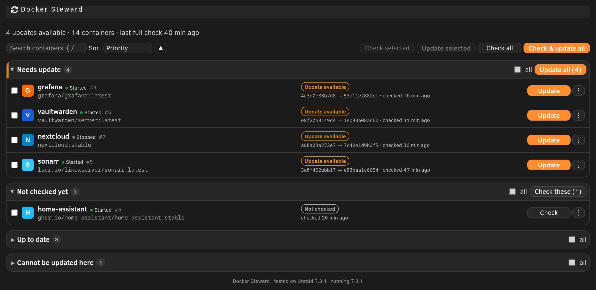
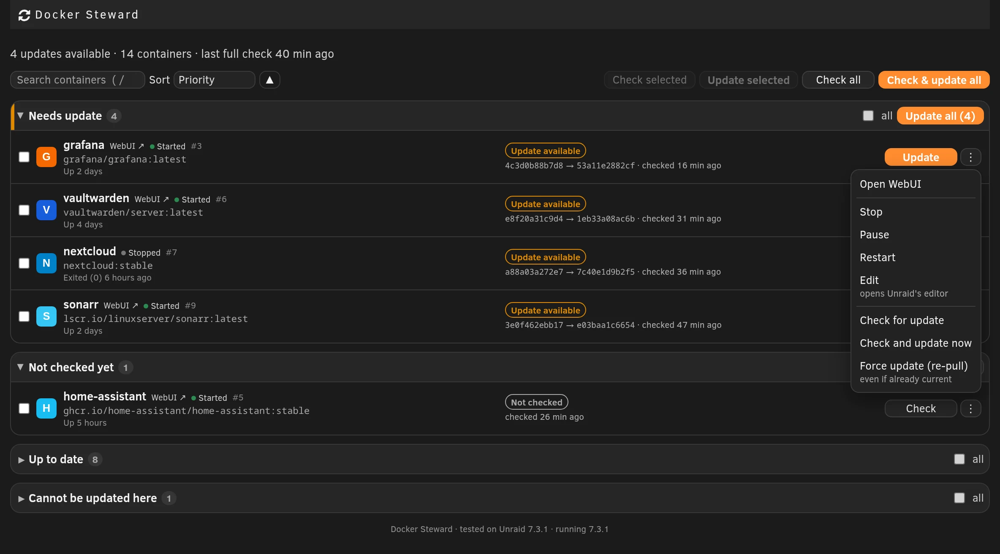
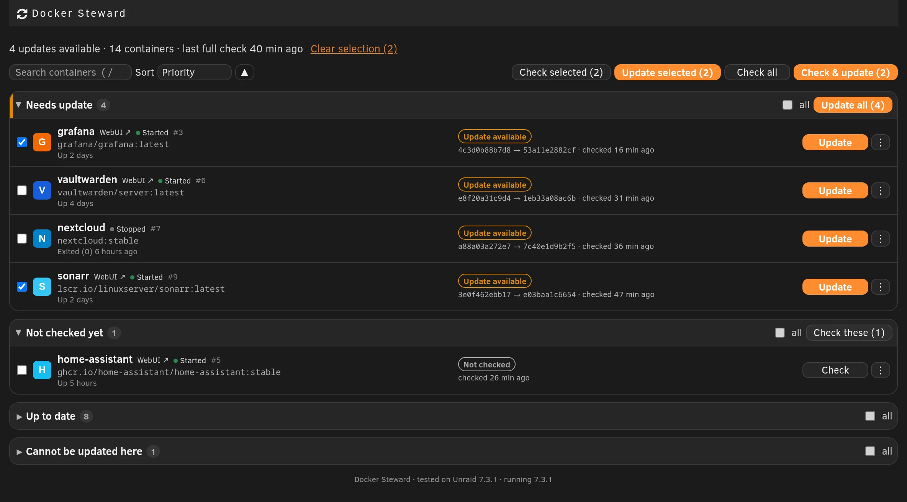
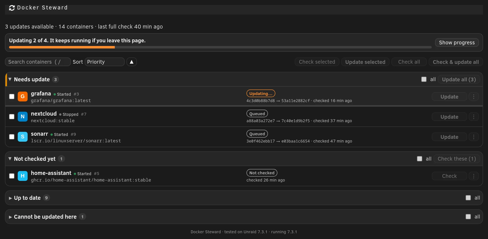
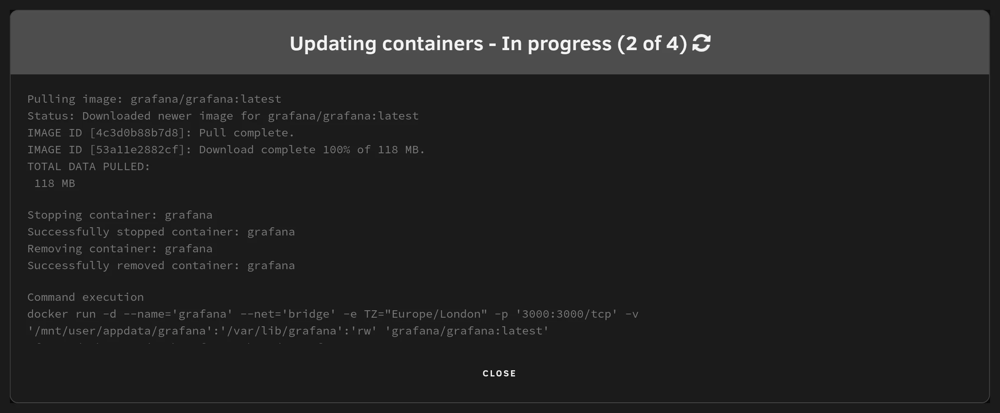
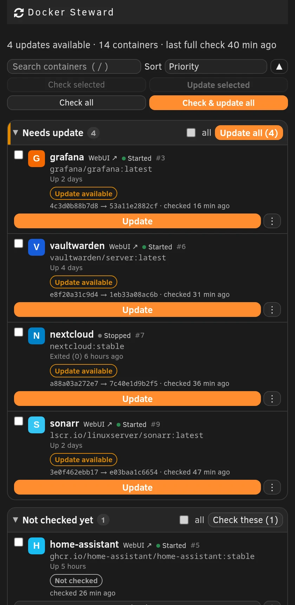
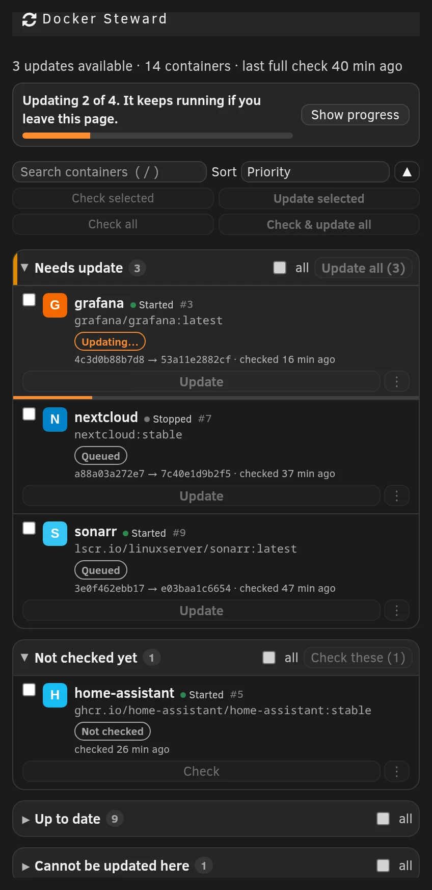

# Docker Steward

<p>
  <a href="LICENSE"></a>
  
</p>

An Unraid plugin for looking after Docker containers. One page lists your containers, shows what needs updating, and
lets you check or update a single container, a selection, or everything, with live progress. Each container's menu also
starts, stops, pauses and restarts it, opens its WebUI, console and logs, and opens Unraid's own editor.

> [!WARNING]
> Docker Steward is provided **as is, with no warranty, and you use it at your own risk**. Updating **recreates
> containers**, which stops and restarts them. Read the [Disclaimer](#disclaimer-use-at-your-own-risk) and keep
> backups of your appdata before you use it on a server you care about.

## Screenshots

Demo data, not a real server.



| | |
|---|---|
|  |  |
| **Row menu:** start, stop, pause, restart, WebUI, console, logs, edit, and update actions | **Selection:** bulk Check, Update and Check & update |
|  |  |
| **Progress:** runs continue in the background | **Live output** from Unraid's update script |

On a phone:

| | |
|---|---|
|  |  |

## Features

- **Per-container update actions:** Check, Update and Re-check on every row, plus a menu with Check and update now and
  Force update (re-pull).
- **Container controls:** Start, Stop, Pause, Resume and Restart from each row's menu, with the container's uptime and a
  WebUI link on the row. These go through Unraid's own Docker functions, the same ones the Docker page calls, and are
  switched off while an update run is in progress.
- **WebUI, Console and Logs:** open the container's web interface and Unraid's own console and log windows.
- **Edit:** opens Unraid's own container editor. Docker Steward never reads or writes container templates.
- **Bulk actions:** Check selected, Update selected, Check all and Check & update. Updates run in your Docker page
  priority order, after a confirmation.
- **Grouped by what needs doing:** Needs update, Not checked yet, Up to date, Cannot be updated here. Search and sort.
- **Live progress:** a popup shows the update output. Runs continue in the background and you can reopen the popup.
- **Honest results:** each container ends as Updated, Already current or Not applied.
- **Compatibility check:** shows a clear notice if an Unraid version needs a plugin update, and lists the Unraid
  versions each release was tested on.
- **Command line:** `docker-steward-check <name> [--json]` and `docker-steward-selftest`.

No Unraid file is modified. It uses Unraid's own update check, update script and container controls, the same ones the
Docker page uses.

## Install

In Unraid, open **Plugins > Install Plugin**, paste this URL and click **Install**:

```
https://raw.githubusercontent.com/cj0r/unraid-docker-steward/main/plugin/docker.steward.plg
```

Then open **Docker > Docker Steward**. Requires Unraid 7.0 or newer.

## Uninstall

**Plugins > Docker Steward > Remove.** The package, its folder on the flash drive, the commands and the temporary
state are all removed.

## Compatibility

Each release records the Unraid versions it was tested on (shown at the bottom of the page and in the changelog). On
an untested version it still runs and says so; where something it needs is missing it switches off only what cannot
work and shows why. `docker-steward-selftest` prints the details.

## Disclaimer: use at your own risk

**Docker Steward is provided "as is", without warranty of any kind, express or implied.** The [LICENSE](LICENSE) has
the full legal text. In plain terms:

- **You use it entirely at your own risk.** The author and contributors accept no responsibility or liability for
  stopped or broken containers, lost data, failed or partial updates, downtime, security incidents, or any other
  damage from using or misusing it.
- **Controls change your containers.** Stop, Pause and Restart interrupt the service a container provides, and a
  stopped container stays stopped until you start it.
- **Updating changes your containers.** An update pulls a new image, then stops, removes and recreates the container.
  A new image version can break an application or its data. Keep backups and know how to roll back.
- **It runs with full administrator rights** inside the Unraid web interface. Only install software you trust.
- **It is not affiliated with or endorsed by** Unraid, Lime Technology or Docker. Their names belong to their owners.

This is a hobby project maintained on a best-effort basis, with no guarantee of support or fixes. Report security
problems privately as described in [SECURITY.md](SECURITY.md).

## AI-assisted development

Docker Steward is developed with the help of AI coding tools. AI-generated code, tests and documentation are
reviewed and tested by the maintainer before release, and the maintainer is responsible for everything in a release.
AI-assisted code can still contain mistakes that review and testing miss, which is one more reason to follow the
disclaimer above. If you find a bug, please [open an issue](https://github.com/cj0r/unraid-docker-steward/issues).

## Support the project

If Docker Steward is useful to you, you can support its development.

<p>
  <a href="https://ko-fi.com/cj000r"></a>
  <a href="https://www.buymeacoffee.com/cj0r"></a>
</p>

## Contributing and license

Bug reports and pull requests are welcome; see [CONTRIBUTING.md](CONTRIBUTING.md). Releases are listed in
[CHANGELOG.md](CHANGELOG.md).

MIT license, see [LICENSE](LICENSE). Inspired by [Docker Batch Update](https://github.com/tabilzad/unraid-docker-batch-update)
by tabilzad, which showed that a batch table for Docker updates was worth having; Docker Steward shares no code with it.
